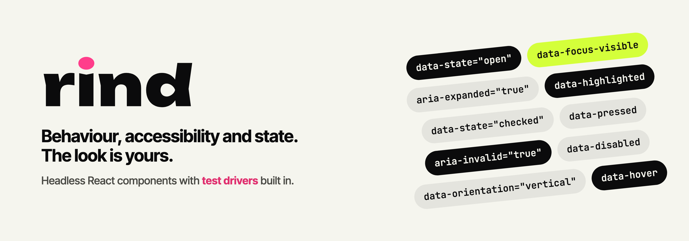

<picture>
  <source media="(prefers-color-scheme: dark)" srcset="docs/media/banner-dark.png">
  
</picture>

<p align="center">
  <a href="https://github.com/WatermelonBros/rind-ui/actions/workflows/ci.yml"></a>
  <a href="LICENSE"></a>
  
  
  <a href="CONTRIBUTING.md"></a>
</p>

<p align="center">
  
  
  
  
  
  
  
</p>

<p align="center">
  <a href="docs/components.md"><b>Components</b></a> ·
  <a href="docs/components/"><b>Docs</b></a> ·
  <a href="llms.txt"><b>llms.txt</b></a> ·
  <a href="CONTRIBUTING.md"><b>Contribute</b></a>
</p>

## Headless components that come with their own tests

rind-ui gives you the hard part of a component library: **behaviour, accessibility and
state**. Every part renders the real element (`<button>`, `<input>`, `<label>`) with
the right roles, ARIA and keyboard support, and exposes its state as `data-*`
attributes. You bring the styles: plain CSS, Tailwind, CSS-in-JS, or the optional theme.

```tsx
import { Accordion } from "@rind-ui/react"

<Accordion.Root defaultValue={["shipping"]}>
  <Accordion.Item value="shipping">
    <Accordion.Header>
      <Accordion.Trigger>Shipping</Accordion.Trigger>
    </Accordion.Header>
    <Accordion.Content>Orders ship within two days.</Accordion.Content>
  </Accordion.Item>
</Accordion.Root>
```

```css
[data-scope="accordion"][data-part="content"][data-state="closed"] { opacity: 0.6 }
[data-scope="accordion"][data-part="trigger"][data-focus-visible] { outline: 2px solid }
```

## Why rind-ui

- **Testable by design.** Every component ships an official **test driver** that works
  in Testing Library and Playwright, plus a machine-readable contract that generates
  **model-based tests** from its state machine. Your tests talk to the component the
  way a user does, and keep working when the markup changes.

  ```ts
  import { getAccordion } from "@rind-ui/testing"

  // `container` from Testing Library, or a Playwright `page`: the same test runs in both.
  const faq = getAccordion(container, { item: "Shipping" })
  await faq.expand("Shipping")
  expect(await faq.expanded()).toEqual(["Shipping"])
  ```

- **Accessibility researched, not assumed.** Before a component is specified, its
  research note reads how every other headless library implemented it and the bugs
  reported against it over the years. Those issues become test scenarios with their
  original conditions. Every story passes axe in Chromium, Firefox and WebKit.
- **Native first.** A link is an `<a>`, a button a `<button>`, closed content uses
  `hidden="until-found"` so find-in-page still works. Custom roles appear only where
  the platform has no element.
- **Small and framework-neutral core.** Behaviour lives in tiny state machines with no
  framework inside; React is the first adapter. The machine runtime is under 2.5 kB
  min+gzip, enforced in CI.
- **White-label theme, optional.** `@rind-ui/theme` derives a full, contrast-checked
  palette from a handful of brand inputs, per scope, in light and dark.
- **Known to LLMs.** [`llms.txt`](llms.txt) and per-component docs are generated from
  the source, so they cannot drift from the code.

## Components

The goal is every component any headless library ships, and more: the full inventory,
with status, is in [`docs/components.md`](docs/components.md).

| Ready | |
|---|---|
| Actions | Button, Link, Toggle, Toggle Group |
| Forms | Label, Field, Fieldset, Form, Text Field, Checkbox, Switch, Checkbox Group, Radio Group, Segmented Control |
| Disclosure | Collapsible, Accordion, Tabs |
| Typography | Heading |

Next up: Separator, Toolbar,
Dialog, Popover, Tooltip, Menu, Select, Combobox, Slider, and the AI-interface
primitives (Prompt Input, Message Thread, Streaming Message, Tool Approval).

## Packages

| Package | |
|---|---|
| `@rind-ui/core` | Framework-agnostic machines, DOM utilities and contracts |
| `@rind-ui/react` | React components |
| `@rind-ui/testing` | Test drivers, DOM and Playwright adapters, model-based tests |
| `@rind-ui/theme` | Optional white-label theme and its typed builder |

> **Status: pre-alpha.** Nothing is published to npm yet; APIs may change.

## Development

```sh
pnpm install
pnpm storybook   # component playground on :6006
pnpm test        # node, jsdom, real browsers, Playwright, Storybook + axe
```

Read [`CONTRIBUTING.md`](CONTRIBUTING.md) before opening a pull request,
[`CLAUDE.md`](CLAUDE.md) for the architecture and conventions, and
[`docs/decisions/`](docs/decisions/) for why things are the way they are. Behaviour is
specified with [OpenSpec](https://github.com/Fission-AI/OpenSpec) in
[`openspec/`](openspec/).

## Contributors

<a href="https://github.com/WatermelonBros/rind-ui/graphs/contributors">
  
</a>

Contributions are welcome: see [`CONTRIBUTING.md`](CONTRIBUTING.md) and the
[Code of Conduct](CODE_OF_CONDUCT.md). Security issues go through
[`SECURITY.md`](SECURITY.md), never a public issue.

## License

[MIT](LICENSE) © rind-ui contributors. Made by [Watermelon Bros](https://github.com/WatermelonBros).
